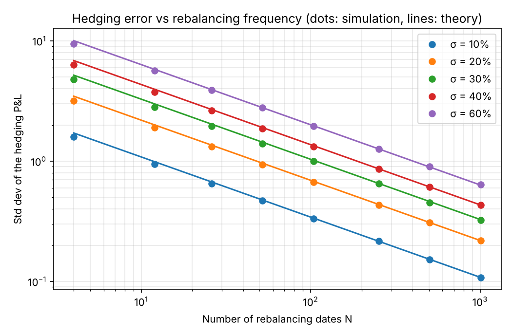
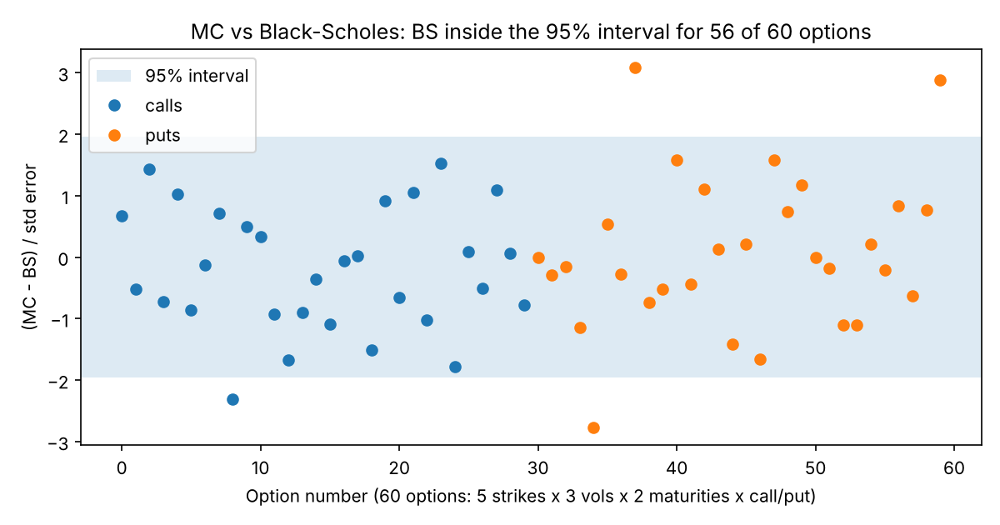
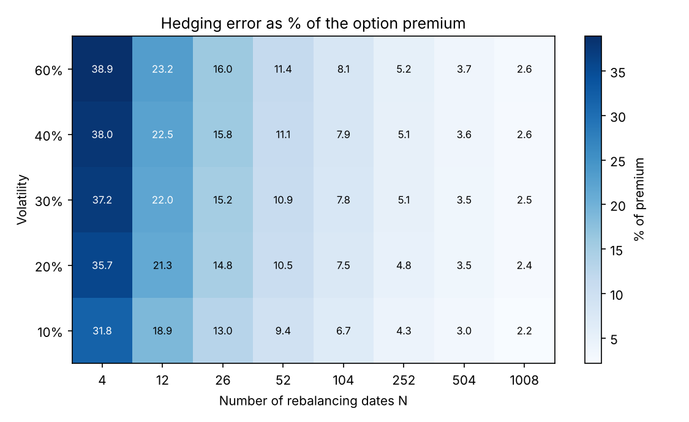
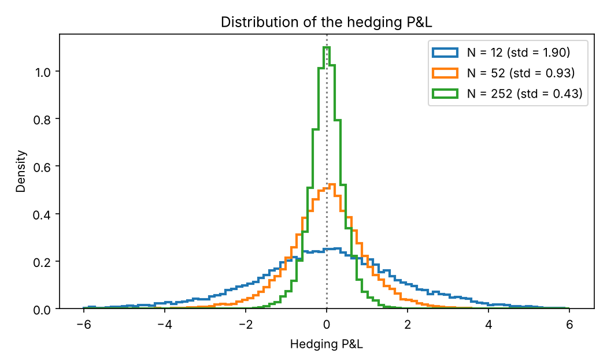
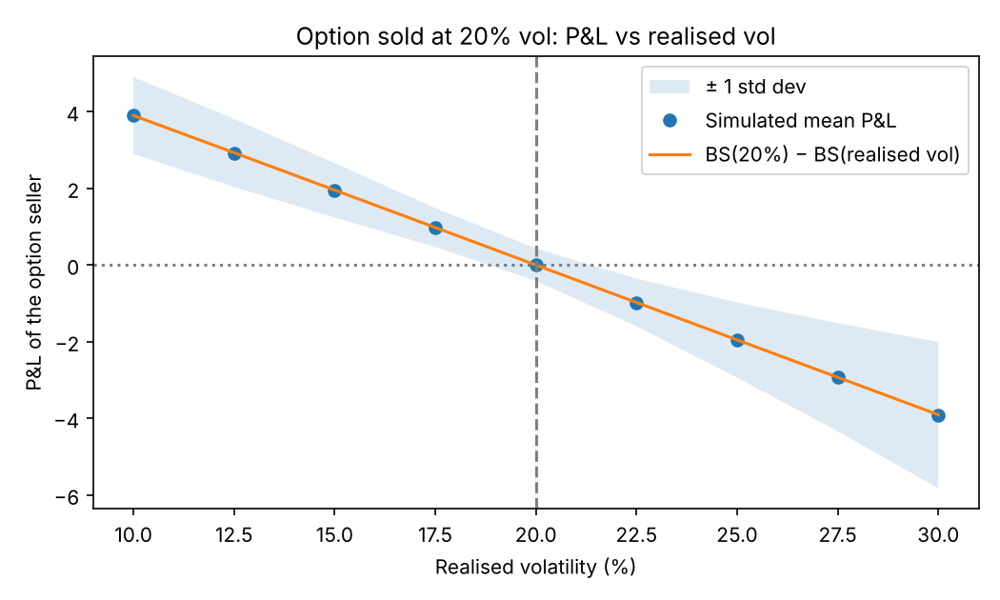
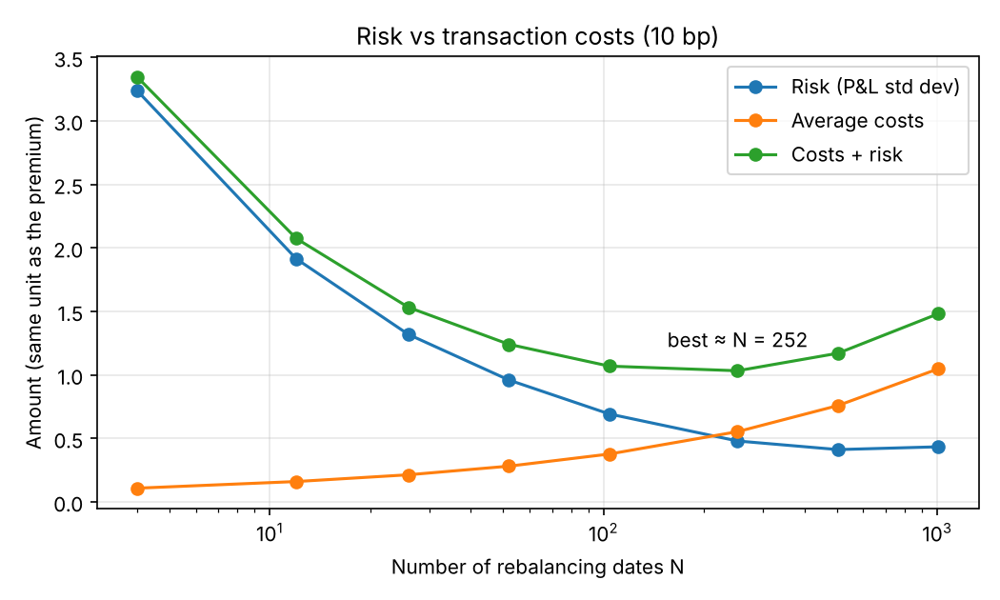

# Monte Carlo Pricing & Discrete Delta Hedging

When a bank sells an option, it does not want to bet on the market. It hedges:
it buys "delta" shares of the underlying so that small moves in the stock cancel
out. Black-Scholes says that if you rebalance this hedge **continuously**, the
risk disappears completely. But a real trader can only rebalance a few times a
day, a week or a month, and every trade costs money.

So in this project I asked three simple questions:

1. Can I price an option with Monte Carlo and get the Black-Scholes price back?
2. If I hedge only N times, how much risk is left, and how does it depend on N and on volatility?
3. What happens when realised volatility is not the one I sold, and when trading costs money?



*Main result: the hedging error falls like 1/√N. Hedging 4 times more often only
halves the risk. The dots (my simulation) sit on the lines (Derman–Kamal formula).*

Base case everywhere: 1-year at-the-money call, S0 = K = 100, r = 2%, σ = 20%,
20,000 simulated paths.

## Part 1: Pricing an option with Monte Carlo

**Idea.** Under the risk-neutral measure, the stock at maturity is
`S_T = S0 · exp((r − σ²/2)T + σ√T·Z)` with Z a standard normal. I draw many Z,
compute the payoff on each path, discount it and take the average. The more paths,
the closer to the true price, but the error only falls like 1/√(number of paths).

To go faster I used two classic tricks:
- **Antithetic variates**: for every draw Z, I also use −Z. The two paths compensate each other.
- **Control variate**: the discounted stock price has a known average (S0). On each run I look
  at how far its simulated average is from S0, and I use that gap to correct the option price.

**Results.**
- ATM call with 500,000 paths: **8.9088 ± 0.0082** vs Black-Scholes **8.9160**.
- The tricks cut the variance by ×1.7 (antithetic), ×5.4 (control variate) and **×23 with both**.
  In practice that means 23 times fewer paths for the same precision.
- I checked 60 options (strikes 80 to 120, vols 10/20/40%, maturities 3 months and 1 year,
  calls and puts): the Black-Scholes price is inside the Monte Carlo 95% interval for
  **56 of 60** options, which is what you expect from a 95% interval (57 of 60).



## Part 2: Hedging only N times

**Set-up.** I sell the call at the Black-Scholes price, buy delta shares and put
the rest of the cash in the bank. At N equally spaced dates I rebalance to the new
delta. At maturity, I pay the option payoff and look at what is left: that is my
hedging P&L. I repeat this on 20,000 paths.

**What theory says.** With the right vol, the P&L is zero on average, and its
standard deviation is about `√(π/4) · vega · σ / √N` (Derman & Kamal, 1999).

**Results.**
- The error really falls like 1/√N: the slope on the log-log chart is **−0.49** for
  every vol (theory −0.5), and the simulation is within about 2% of the formula
  (8% at N = 4, where the formula is only rough).
- As a **% of the premium**, the error barely depends on the vol, only on N:
  about **10% with weekly** hedging, **5% daily** and 2.5% four times a day.



- The P&L is centred on zero but has fat tails when N is small. The big losses come
  when the stock is close to the strike near maturity: there gamma is huge, so the
  delta moves a lot between two rebalancing dates.



## Part 3: Two real-life problems

**Wrong volatility.** I sell the option at 20% vol, but the stock actually moves
with another vol. The average P&L is almost exactly `BS(20%) − BS(realised vol)`
(gap below 0.01). If realised vol is 30%, I lose about **3.9 per option**, i.e. 44%
of the premium. This is the core of a vol trader's job: the hedge removes the
direction, but you are still long or short volatility.



**Transaction costs (10 bp).** Hedging more often reduces risk (1/√N) but each trade
costs money, and costs grow roughly like √N. If I add the two, the best compromise
is around **N = 250, i.e. hedging once a day**. Hedging more than that just pays
the broker.



## Conclusion

- Monte Carlo gives the right price, and two simple tricks make it 23 times more efficient.
- Delta hedging never removes all the risk: what is left falls slowly, like 1/√N.
- In practice, daily hedging is a good trade-off between risk and costs.
- The real risk of an option seller is volatility, not the direction of the stock.

To go further: stochastic volatility (Heston), hedging only when delta moves
enough instead of on fixed dates, exotic options (barriers, Asians).

## How to run it

```bash
pip install -r requirements.txt
python run_analysis.py      # about 40 seconds, writes everything in results/
python -m pytest -q         # 9 quick checks (put-call parity, MC vs BS, 1/√N, ...)
```

The code is in `mchedge/`: `black_scholes.py` (formulas), `monte_carlo.py`
(pricer) and `hedging.py` (hedging simulation). The random seed is fixed, so the
numbers above come out the same every time.


